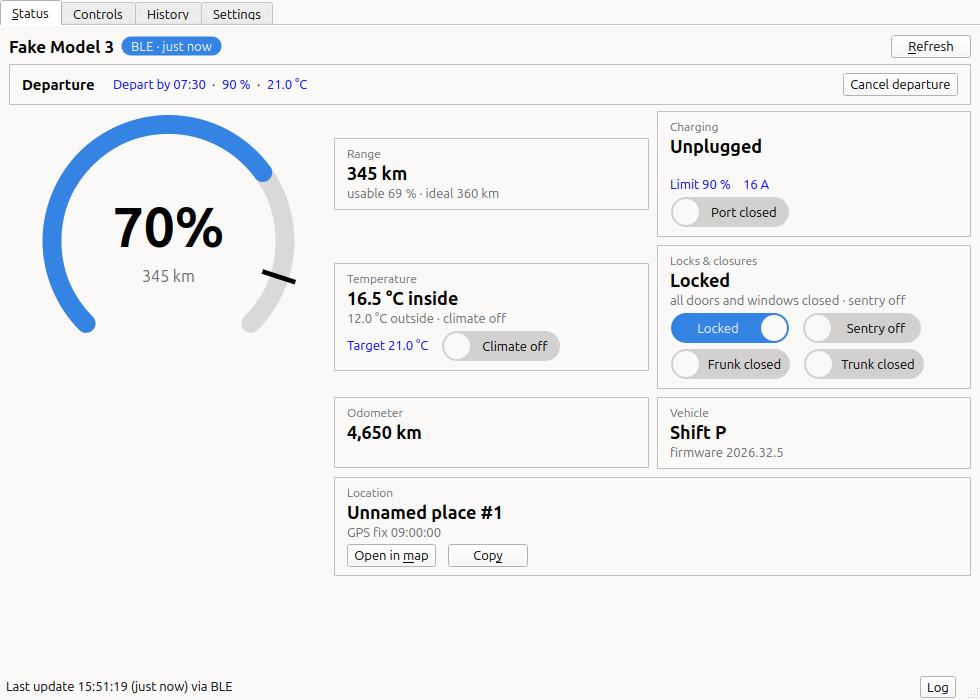
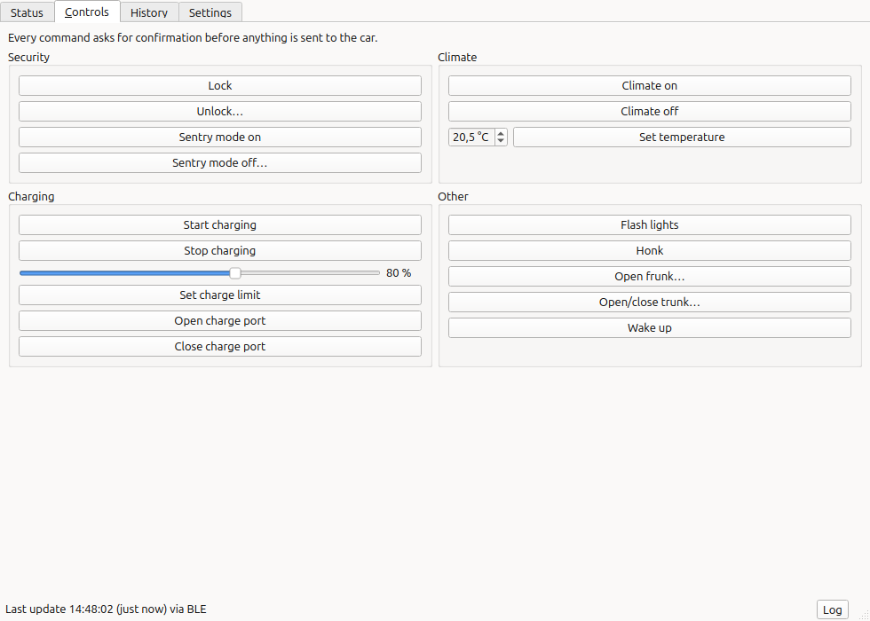
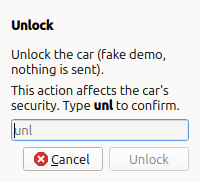
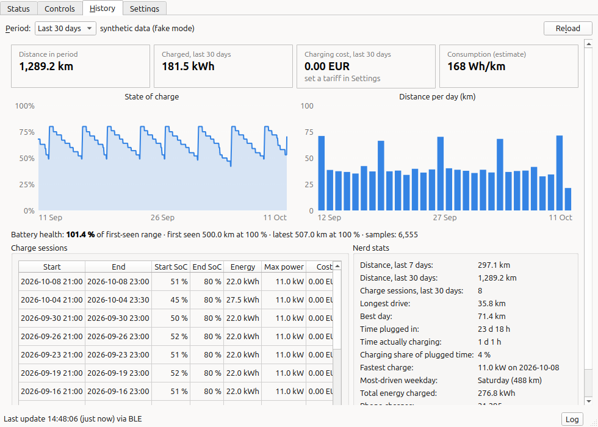
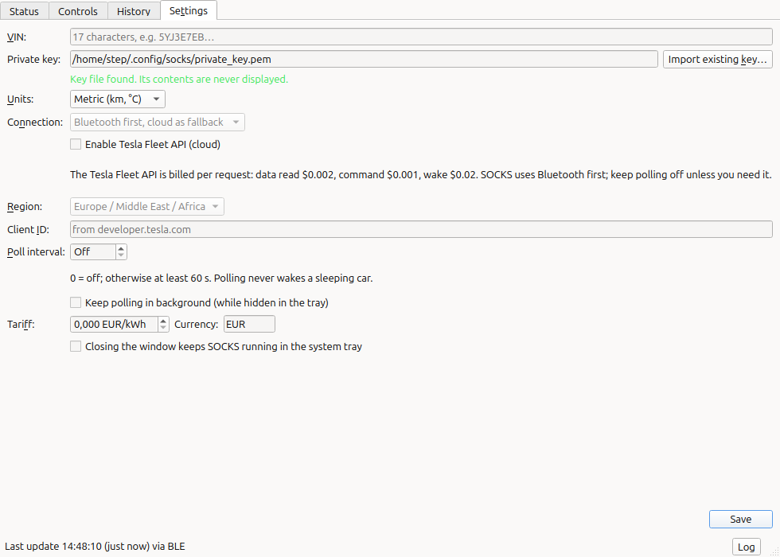

# SOCKS: State Of Charge, Keys & Stats

**A lean, local-first Tesla companion for Linux: Bluetooth control, charge status, and a private history of what you drove and charged.**



## Why

- **Lean.** Three runtime dependencies, no background daemon, usable window in under a second.
- **Local-first.** Your key, your history and your settings stay on your computer. No telemetry,
  no update checks, no account.
- **No cloud needed.** Talks to the car directly over Bluetooth. The Tesla Fleet API is an
  optional extra for when you are out of range.
- **Open source.** GPL-3.0-or-later. Protocol work is Tesla's own open source library,
  [`tesla-fleet-api`](https://github.com/Teslemetry/python-tesla-fleet-api); SOCKS adds no crypto.
- **Everywhere.** Qt 6; same on KDE, GNOME, XFCE, X11 and Wayland; follows system theme and dark mode.

## Features

**Status:** state of charge, range, charging, temperatures, locks and closures, odometer.

**Controls:** lock/unlock, climate and temperature, charge start/stop, charge limit, charge port,
flash/honk, frunk/trunk, sentry, wake. Every command asks for confirmation; dangerous ones
(unlock, frunk/trunk, sentry off) make you type the first letters of the action.





**History:** distance per day, charge sessions and cost (set your tariff), consumption,
state-of-charge curve, battery health trend, plus some nerd stats. Metric by default,
imperial switchable.



**Settings:** VIN, units, Bluetooth/cloud preference, polling, tariff. The screenshots above
use `--fake` (a simulated car and synthetic data).



## Requirements

- Linux with BlueZ 5.x and a Bluetooth LE adapter; keep the laptop within about 10 m of the car.
  Your user usually does not need to be in the `bluetooth` group (Ubuntu and Fedora allow
  desktop users by default); add it only if BlueZ polkit rules on your distro require it.
- A Tesla with Bluetooth phone-key support: Model 3 and Y (all years), Model S and X (2021 and later).
- Python 3.13, or the Flatpak (which needs access to BlueZ on the system bus,
  `--system-talk-name=org.bluez`). Nothing else at runtime.
- Cloud (optional): a Tesla account with MFA, a Tesla developer application, a domain you control
  serving the public key over valid TLS, and a payment card at Tesla (the billing limit is 0
  otherwise). Prices: data $0.002, command $0.001, wake $0.02, with a $10 per month discount.

## Install

Needs Python 3.13 and BlueZ. Step-by-step with distro package names: [docs/HOWTO.md](docs/HOWTO.md).

```bash
uv tool install socks-tesla     # or: pipx install socks-tesla
```

From source:

```bash
git clone https://github.com/stepspower/socks && cd socks
uv venv --python 3.13 && uv pip install -e ".[dev]"
.venv/bin/socks
```

Flatpak (Flathub): coming.

## Quick start

1. **Key.** Import a key already paired with your car, or create a new one:
   ```bash
   socks-cli key import /path/to/private_key.pem   # existing, already paired
   socks-cli key generate                          # or: make a new one
   ```
2. **Pair** a new key with the car (stand next to it, key card ready):
   ```bash
   socks-cli key pair [--role driver|owner] [--vin VIN]
   ```
   It prints "Tap your key card on the centre console to confirm (waiting up to 60 s)". Tap the
   card; the command succeeds when the car confirms. On timeout, check the car's Locks screen.
   Skip this if you imported an already-paired key.
3. **Run** `socks`, enter your VIN on the Settings tab, and press Refresh.

Try it without a car: `socks --fake` or `socks-cli --fake status`.

## Optional cloud

The Fleet API gives remote access when Bluetooth is out of range. It needs a Tesla developer app
and a public key hosted on a domain you control: follow
[docs/FLEET_API_SETUP.md](docs/FLEET_API_SETUP.md). Tesla bills per request: data read $0.002,
command $0.001, wake $0.02, with a $10 per month discount. SOCKS tries Bluetooth first and
polling is off by default, so most people pay nothing.

## Privacy and security

- No telemetry. The only network traffic is to Tesla endpoints you enabled (cloud is off by default).
- Private key and tokens live in `$XDG_CONFIG_HOME/socks/` (directory 0700, files 0600), never
  logged and never in the database. History is a local SQLite file in `$XDG_DATA_HOME/socks/`.
- All state-changing commands go through one confirmation gate.
- See [docs/SECURITY.md](docs/SECURITY.md) (threat model, reporting) and the
  [security audit](docs/AUDIT-2026-10-11.md).

## Troubleshooting

| Symptom | Try |
|---|---|
| "No Bluetooth adapter" or permission errors | `systemctl status bluetooth`; `bluetoothctl show` must list a controller; make sure Bluetooth is not blocked (`rfkill list`). Your user normally needs no extra group. |
| Car not found / timeouts | The car is asleep or out of range (about 5 to 10 m). Stand next to it, wake it with a door or the Tesla app, retry. |
| Fleet login: "Only local hosts" | Tesla's portal accepts plain `http://` redirect URIs only for `localhost` with a port. Register exactly the three `http://localhost:5368x/callback` URIs from the setup guide. |
| Wrong or no data | Check the VIN (17 characters) on the Settings tab; run `socks --debug` for a log. |

## Contributing

See [CONTRIBUTING.md](CONTRIBUTING.md) and [docs/ARCHITECTURE.md](docs/ARCHITECTURE.md).

## Trademark

Tesla is a trademark of Tesla, Inc. This project is not affiliated with, endorsed by, or
sponsored by Tesla, Inc.

## License

GPL-3.0-or-later, see [LICENSE](LICENSE).
